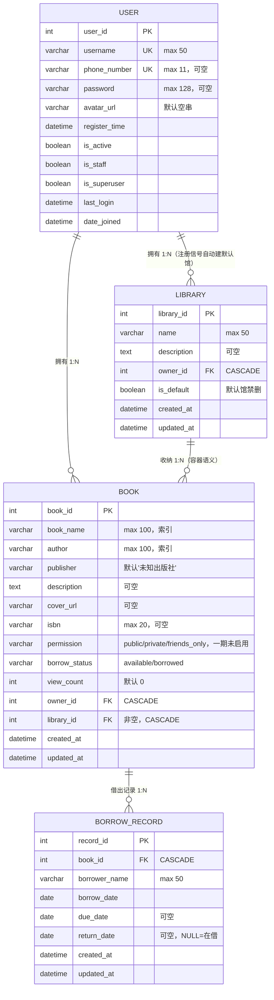

# 02 · 数据库设计（v0.1.0）

> 本文与 `app/models/` 逐一对应，是模型代码的设计快照；模型如有演进，以代码为准并回写本文。
> 关联文档：[01_需求与范围](./01_需求与范围.md) · [03_API契约](./03_API契约.md) · [04_安全与设计决策](./04_安全与设计决策.md)

## 1. 总览与 ER 图

4 张业务表：`user` / `library` / `book` / `borrow_record`。

## 2. 字段明细

### 2.1 user（用户表，`app/models/user.py`）

基于 `AbstractUser` 扩展：自定义主键、放宽部分继承字段的可空性。

| 字段 | 类型 | 约束 | 说明 |
|---|---|---|---|
| user_id | AutoField | PK | 自定义主键，替代默认 id |
| username | varchar(50) | unique, 必填 | 登录凭证（USERNAME_FIELD） |
| password | varchar(128) | 可空 | 重写为可空，预留无密码场景 |
| first_name / last_name / email | — | 可空 | 重写 AbstractUser 继承字段，降低注册门槛 |
| avatar_url | varchar(255) | 默认 "" | 头像 |
| phone_number | varchar(11) | unique, 可空 | 手机号注册/登录；可空 unique 允许多行 NULL |
| register_time | datetime | default now | 注册时间 |
| is_active / is_staff / is_superuser / last_login / date_joined | — | 继承 | Django 认证体系内置 |

自定义 `UserManager`：`create_user` 支持"只给手机号"时用手机号占位用户名；无密码时 `set_unusable_password()`。

### 2.2 library（图书馆表，`app/models/library.py`）

| 字段 | 类型 | 约束 | 说明 |
|---|---|---|---|
| library_id | AutoField | PK | |
| name | varchar(50) | (owner, name) 唯一 | 同一用户内馆名不重复 |
| description | text | 可空 | 简介 |
| owner | FK → user | CASCADE | 删用户连带删馆 |
| is_default | boolean | 默认 False | 默认馆禁删（应用层 400 拦截） |
| created_at / updated_at | datetime | auto | |

类方法 `create_default_for_user(user)`：注册信号调用，创建"我的图书馆"（`is_default=True`）。

### 2.3 book（图书表，`app/models/book.py`）

| 字段 | 类型 | 约束 | 说明 |
|---|---|---|---|
| book_id | AutoField | PK | |
| book_name | varchar(100) | 索引 | 模糊搜索目标字段 |
| author | varchar(100) | 索引 | 模糊搜索目标字段 |
| publisher | varchar(100) | 默认"未知出版社" | |
| description | text | 可空 | 书籍简介 |
| cover_url | varchar | 可空 | 封面 |
| isbn | varchar(20) | 可空 | 预留外部元数据 |
| permission | varchar(12) | choices，默认 public | **一期预留未启用**（public/private/friends_only） |
| borrow_status | varchar(10) | choices，默认 available | 冗余"当前态"，与借阅记录事务内同步 |
| view_count | int | 默认 0 | |
| owner | FK → user | CASCADE | 书主 |
| library | FK → library | **非空**，CASCADE | 容器语义：书必须归馆 |
| created_at / updated_at | datetime | auto | ordering: -created_at |

### 2.4 borrow_record（借阅记录表，`app/models/borrow.py`）

| 字段 | 类型 | 约束 | 说明 |
|---|---|---|---|
| record_id | AutoField | PK | |
| book | FK → book | CASCADE | 删书连带删记录 |
| borrower_name | varchar(50) | 必填 | 借给谁（一期为自由文本，非系统用户） |
| borrow_date | date | auto_now_add | 借出日期 |
| due_date | date | 可空 | 约定归还日期（API 层校验不得早于今天） |
| return_date | date | **可空，NULL=在借** | 归还即写入；状态单一数据源 |
| created_at / updated_at | datetime | auto | ordering: -created_at |

派生属性 `status`（不落库）：`return_date` 非空 → `returned`，否则 `borrowing`。

## 3. 约束与索引

**唯一约束**

| 约束 | 位置 | 防护目标 |
|---|---|---|
| username unique | user | 用户名重复 |
| phone_number unique | user | 手机号重复 |
| unique_together (owner, name) | library | 同一用户馆重名 |
| `unique_active_borrow_per_book`（部分唯一：book WHERE return_date IS NULL） | borrow_record | 一本书同时最多一条在借，**并发窗口兜底** |

**索引**

- `book.book_name`、`book.author`：当前同时存在字段级 `db_index=True` 与 `Meta.indexes`，属**冗余双索引**，二期收敛为保留其一。
- 所有外键列由 Django 自动建索引（owner_id / library_id / book_id）。

**级联删除链（容器语义）**

| 删除对象 | 连带后果 |
|---|---|
| User | 全部 Library → Book → BorrowRecord（CASCADE 全链路） |
| Library | 馆内全部 Book 及其 BorrowRecord |
| Book | 其 BorrowRecord |

例外保护：默认馆 `is_default=True` 禁删、借出中书不可重复借出（均为应用层校验，返回 400）。

## 4. 迁移历史

| 迁移文件 | 内容 |
|---|---|
| 0001_initial | user 表 |
| 0002_book | book 表（彼时尚无 library 字段） |
| 0003_library_book_library | 新增 library 表；book 增加可空 library 外键（三步迁移第 ① 步） |
| 0004_alter_book_library | book.library 改回非空（第 ③ 步；第 ② 步为 shell 回填存量数据，不产生迁移文件） |
| 0005_borrowrecord_and_more | borrow_record 表 + unique_active_borrow_per_book 部分唯一约束 |

> **三步迁移范式**（存量表加非空外键）：① 加 `null=True` 并迁移 → ② 回填存量数据 → ③ 去掉 `null=True` 再迁移。`makemigrations` 的提问只对比模型与迁移定义、不查实际数据——只要已验证无 NULL 行，对第 ③ 步的提问选 Ignore 是安全的。

## 5. 关键设计决策（数据库层）

1. **容器级联链**：书脱离馆无独立存在意义，故 `Book.library=CASCADE` 而非 `SET_NULL`；用户注销同理全链路清除，不留孤儿数据。
2. **在借唯一性双保险**：应用层先校验 `borrow_status != available` 返回 400（友好），DB 层部分唯一约束兜底并发窗口（正确）。只靠前者有 TOCTOU 竞态，只靠后者会把 `IntegrityError` 以 500 暴露给用户。
3. **状态单一数据源 + 冗余当前态**：`BorrowRecord.status` 为派生 property，不落库，杜绝状态字段与日期不一致；`Book.borrow_status` 是为列表高效过滤保留的冗余当前态，两者在同一事务内同步，若不一致以 `return_date` 回算为准。
4. **permission 字段预留**：表结构一期即含共享权限枚举，接口未启用——二期启用无需再动表结构；代价是暂存无业务读取的字段，如实记录于此。